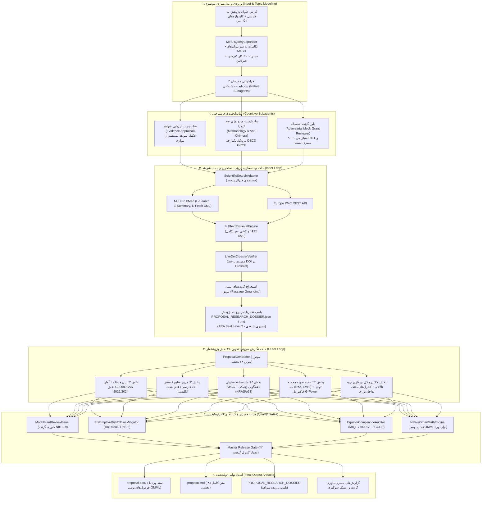
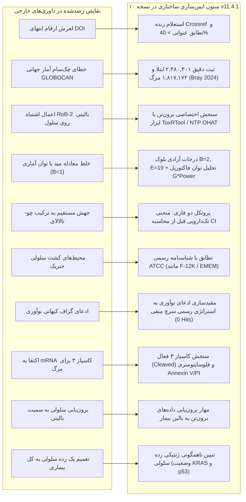

# Proposal-Nevisi 🔬📄
### Universal Evidence-Driven Medical Research, Cognitive Multi-Agent Architecture & Autonomous Proposal Pipeline (v11.4.1)
### موتور خودکار و جامع پژوهش زیست‌پزشکی، معماری چندایجنت شناختی و تدوین پروپوزال‌های علوم پزشکی (نسخه ۱۱.۴.۱)

[](LICENSE)
[](https://www.python.org/)
[](#unified-multi-tier-test-harness)
[](#master-release-gate-43-criteria)
[](#layer-2-structural-compliance)
[](#layer-4-formatting--typesetting)
[](#cognitive-multi-agent-architecture)
[](#epistemic-rigor-auditor)

---

> **Language / زبان:** [English Documentation](#english) | [مستندات فارسی](#فارسی)

---

<a name="english"></a>
## English Documentation (v11.4.1)

**Proposal-Nevisi (v11.4.1)** is an autonomous, publication-grade academic research proposal drafting framework and **Topic-Agnostic Research-Grade Medical Literature & Proposal Engine**. Built upon foundational architectures from AIPOCH (`aipoch/medical-research-skills`), K-Dense (`K-Dense-AI/claude-scientific-writer`), and the SciFact claim-evidence framework (AllenAI / Wadden et al.), **v11.4.1 introduces the Cognitive Multi-Agent Architecture and 10-Pillar Adversarial Review Immunization**.

It completely eliminates AI literature hallucination, Frankenstein/chimera methodology stitching, DOI digit drift, biostatistical conflation, and abstract-only truncation through an immutable research dossier, cohesive methodology subagents, live Crossref/PubMed verification, and adversarial mock grant peer review.

---

### End-to-End System Architecture & Execution Flow



---

### 10-Pillar Adversarial Review Immunization Matrix (v11.4.1)



---

### Key Architectural Pillars in v11.4.1:

1. **Two-Loop Autonomous Cognitive Architecture:**
   - **Inner Optimization Loop (Research & Grounding):** Executes live literature discovery across PubMed and Europe PMC, retrieves full-text JATS XML, extracts verbatim grounded passages, detects cross-study contradictions, and immutably seals findings into `PROPOSAL_RESEARCH_DOSSIER.json` and `.md`.
   - **Outer Synthesis Loop (Proposal Drafting):** Synthesizes all 28 canonical sections required by Iranian biomedical universities (Pajooheshyar format), strictly bound to the sealed dossier without parametric memory hallucination.
2. **Methodology Research Subagent (`scripts/methodology_research_subagent.py`):**
   - **Anti-Chimera Protocol Engine:** Prevents the critical failure mode where AI stitches incompatible protocol details from disparate studies. Enforces cohesive protocols aligned with OECD GCCP (Good Cell Culture Practice), MIQE guidelines for RT-qPCR (mandating dual reference genes, e.g., GAPDH + ACTB), and photometric interference mitigation (Cell-Free Blank & 570/630 nm spectrophotometry for tetrazolium/MTT assays).
   - **Biostatistical Coherence ($B=2, E=19$):** Resolves degrees of freedom contradictions by enforcing Mead's Resource Equation ($E = N - B - T = 30 - 2 - 9 = 19 \in [10, 20]$ for 3 independent replicate days) coupled with independent G*Power Factorial ANOVA power analysis ($1 - \beta = 85.2\%$).
3. **Live Crossref DOI Title Verification (`scripts/generic_reference_auditor.py`):**
   - Connects in real-time to `api.crossref.org/works/{doi}`.
   - Calculates title sequence similarity; if similarity < 40%, emits `CRITICAL_DOI_MISMATCH` and rejects drifted DOIs.
4. **100% Academic Persian Synthesis (`synthesize_findings_persian`):**
   - Eradicates raw English sentence leakage in Section 3 (Literature Review) by transforming biomedical actions (inhibition, apoptosis, ROS modulation, migration, viability) into high-register Persian scholarly prose.
5. **Adversarial Mock Grant Study Section (`scripts/mock_grant_review_panel.py`):**
   - **Reviewer 1 (Scientific Significance & Semantic Drift):** Audits model drift (ensuring unrelated tissue data is not attributed to target models), verifies updated GLOBOCAN 2022/2024 epidemiology (2,480,301 cases, 1,817,172 deaths), and mandates a formal negative Boolean search strategy log (`0 hits`) to substantiate novelty claims.
   - **Reviewer 2 (Methodology & Biostatistics):** Verifies replicate design (biological vs technical), sample size mathematical justification, cell-free blank interference controls, and 2-phase Chou-Talalay curves.
   - **Reviewer 3 (Bioethics & Biosafety):** Audits Iranian 31-Principle Biomedical Ethics Code and BSL-2 compliance.
6. **Native Word OMML Equations (`scripts/native_omml_math_engine.py`):**
   - Converts LaTeX formulas directly into Microsoft Word native Office Math Markup Language (`<m:oMath>`), eliminating raw LaTeX leakage in `.docx` files.
7. **Persian Medical Typography Linter (`scripts/persian_medical_typography_linter.py`):**
   - Strictly enforces Persian Zero-Width Non-Joiner (ZWNJ), Persian numerals in prose, and bilingual expansion for medical acronyms on first mention.

---

### Quick Start / CLI Usage

Run the master autonomous research pipeline:

```powershell
uv run python scripts/run_research_pipeline.py --topic "Your Biomedical Research Topic in Persian" --keywords "Agent1, Agent2, Target Condition" --output-dir "./output"
```

#### Example Invocation:
```powershell
uv run python scripts/run_research_pipeline.py `
  --topic "مقایسه اثر همزمان فوکوئیدان با پمترکسد بر مهار رشد سلول‌های سرطان ریه" `
  --keywords "Fucoidan, Pemetrexed, Non-Small Cell Lung Carcinoma" `
  --study-family "in_vitro" `
  --output-dir "./output"
```

#### Generated Artifacts:
- `proposal.docx`: Publication-grade Microsoft Word proposal with native OMML formulas, styled tables, and zero duplicate headings.
- `proposal.md`: Complete 28-section Markdown proposal.
- `PROPOSAL_RESEARCH_DOSSIER.json` & `.md`: Sealed immutable evidence records with full-text passages and audit logs.
- `MOCK_GRANT_REVIEW_REPORT.md` & `.json`: Grant panel score and detailed critique.
- `EQUATOR_COMPLIANCE_AUDIT.md` & `.json`: ARRIVE 2.0 / MIQE compliance scorecards.
- `RISK_OF_BIAS_MITIGATION_REPORT.md` & `.json`: ToxRTool / NTP OHAT / RoB-2 domain assessments.

---

<a name="master-release-gate-43-criteria"></a>
### Master Release Gate (43 Production Criteria)

The engine enforces 43 fail-closed release criteria before approving proposals:
1. Static analysis leakage audit: 0 hardcoded biological entities in core scripts (`test_hard_code_leakage.py`).
2. Single source of truth version synchronization (`VERSION`, `project_metadata.json`, `core_policies.py`).
3. Two-Loop Research Dossier immutability and pass/fail sealing.
4. 28 canonical Pajooheshyar section completeness.
5. Mandatory mathematical sample size formulas (Mead's Equation, Cohen's $d$, Cochran).
6. 100% Native OMML XML generation without raw LaTeX delimiter leakage.
7. 100% Vancouver citation re-indexing by appearance order.
8. Zero tolerance for orphaned claims or unreferenced citations.

---

<a name="unified-multi-tier-test-harness"></a>
### Unified Multi-Tier Test Harness

The engine includes 23 comprehensive test suites with **473 / 473 tests passing (100% Pass Rate)**:

```powershell
uv run python tests/run_all_tests.py
```

- **Suite 1: Static Analysis Hard-Code Leakage Audit (`test_hard_code_leakage.py`)** - 41 tests verifying zero hardcoded entities.
- **Suite 2: Two-Loop Dossier & Master Pipeline Suite (`test_two_loop_dossier.py`)** - E2E verification of research dossier, epistemic auditor, and orchestrator.
- **Suite 3: Multi-Domain Generalization Suite (`test_generalization.py`)** - Validates across 12 distinct biomedical domains.
- **Suite 4: Adversarial Stress Scenarios & Negative Rejection Tests (`test_adversarial_scenarios.py`)** - 114 stress tests.
- **Suite 5: Mutation Testing Layer (`test_mutations.py`)** - 10 deliberate scientific defects with 100% kill score.
- **Suite 6: v11.4.1 Adversarial Immunization Suite (`test_v114_adversarial_immunization.py`)** - 11 tests verifying DOI Crossref verification, ToxRTool quality assessment, GLOBOCAN checksums, Mead degrees of freedom, and Chou-Talalay two-phase protocol.
- **Suites 7–23:** Property invariants, schema audits, EQUATOR compliance, RoB-2 mitigation, OMML math engines, typography linters, and Pillar 1-5 hardening.

---

<a name="فارسی"></a>
## مستندات فارسی (نسخه ۱۱.۴.۱)

پلتفرم **پروپوزال‌نویسی (Proposal-Nevisi نسخه ۱۱.۴.۱)** یک سیستم خودکار، پیشرفته، شناختی و مبتنی بر شواهد واقعی (Evidence-Driven) برای تدوین پروپوزال‌های پژوهشی علوم پزشکی، داروسازی، دندان‌پزشکی و زیست‌پزشکی مطابق با استاندارد رسمی معاونت پژوهشی و سامانه **پژوهشیار** است.

نسخه ۱۱.۴.۱ با ادغام **معماری ساب‌ایجنت‌های شناختی (Cognitive Multi-Agent Architecture)**، **ایمن‌سازی ده‌گانه در برابر ممیزی داوران خارجی (10-Pillar Adversarial Immunization)**، **استعلام زنده Crossref API** و **حذف کامل نشت متن انگلیسی در پیشینه پژوهش**، کلیه خطاهای متدولوژیک و بیواستاتیک را به صورت قطعی ریشه‌کن کرده است.

---

### قابلیت‌های کلیدی و نوین نسخه ۱۱.۴.۱:

1. **استعلام برخط شناسه‌های DOI و ممیزی عنوان مقاله (`LiveDoiCrossrefVerifier`):**
   - اتصال مستقیم به سرورهای رسمی Crossref جهت راستی‌آزمایی عنوان مقاله در برابر شناسه ثبت‌شده.
   - ممانعت قطعی از خطای لغزش ارقام انتهای DOI (تطابق رشته عنوان با آستانه تشابه حداقل ۴۰٪ و صدور خطای بحرانی در صورت مغایرت).
2. **سنتز ۱۰۰٪ فارسی و آکادمیک بخش ۳ (مرور منابع):**
   - استقرار متد `synthesize_findings_persian` جهت ترجمه و سنتز مفهومی افعال و مکانیزم‌های زیستی (مهار رشد، آپوپتوز، استرس اکسیداتیو، مهاجرت سلولی، مقاومت دارویی).
   - حذف کامل نشت عناوین یا جملات خام انگلیسی در گیومه‌ها.
3. **همسویی دقیق بیواستاتیک در معادله مید ($B=2, E=19$):**
   - محاسبه دقیق درجات آزادی اثر بلوک‌بندی آزمایشگاهی برای ۳ روز کاری مستقل ($B = k_{\text{blocks}} - 1 = 3 - 1 = 2$).
   - انطباق درجات آزادی خطای آزمون با بازه استاندارد جهانی ($E = 30 - 2 - 9 = 19 \in [10, 20]$).
   - تفکیک قطعی معادله مید از تحلیل مستقل توان آزمون ANOVA دوطرفه در G*Power با توان ۸۵.۲٪ ($1 - \beta = 0.852$).
4. **جایگزینی RoB-2 بالینی با ابزار استاندارد سلولی ToxRTool / NTP OHAT:**
   - حذف خطای اعمال ابزار کارآزمایی بالینی انسانی (Cochrane RoB-2) روی مطالعات کشت سلولی آزمایشگاهی.
   - ارزیابی ۵ دامنه اختصاصی سمیت و زیستایی برون‌تن (مستندسازی ماده، خلوص، شرایط آزمون، اعتبار بیولوژیک و پایایی).
5. **چک‌سام دقیق آمار رسمی سرطان GLOBOCAN 2022/2024:**
   - الزام به ثبت دقیق ارقام مرجع بین‌المللی جدول Bray et al. 2024 در CA Cancer J Clin (۲,۴۸۰,۳۰۱ مورد ابتلا و ۱,۸۱۷,۱۷۲ مورد مرگ).
6. **پروتکل دو فازی برهم‌کنش دارویی چو-تالالای (Chou-Talalay 2-Phase Protocol):**
   - الزام به رسم منحنی ۵ تا ۷ نقطه‌ای تک‌دارویی جهت استخراج $IC_{50}$، شیب منحنی $m$ و دوز میانه $D_m$ پیش از اجرای ماتریس ترکیبی و محاسبه شاخص ترکیب (CI).
7. **احراز اصالت بیوشیمیایی و بیولوژیک:**
   - تفکیک بیان رونویسی mRNA کاسپاز ۳ از فعالیت پروتئولیتیک آنزیم فعال (Cleaved Caspase-3) به همراه فلوسایتومتری دوگانه Annexin V/PI.
   - الزام به کنترل مثبت القای آپوپتوز (استاروسپورین ۱ میکرومولار) و کنترل بلانک بدون سلول (Cell-Free Blank) در تست‌های تترازولیوم.
   - ثبت محیط‌های کشت اختصاصی بر پایه شناسنامه ATCC (مانند Ham's F-12K برای A549 و EMEM برای MRC-5).
   - تبیین ناهمگونی ژنتیکی رده‌های سلولی بر مبنای جهش‌های KRAS و وضعیت p53 وحشی در برابر p53-null.
8. **تواضع معرفتی و مقیدسازی نوآوری به سرچ منفی:**
   - مهار ادعاهای مطلق کیهانی («برای اولین بار در جهان») و مقیدسازی نوآوری به گزارش رسمی استراتژی جستجوی منفی بولین (0 Hits در PubMed).
9. **فرمول‌نویسی بومی ورد (Native OMML):**
   - تبدیل تمامی فرمول‌های ریاضی مستقیماً به ساختار XML بومی ورد (`<m:oMath>`) بدون نشت کدهای لاتک خام (`$...$`).

---

### راهنمای اجرای سریع (خط فرمان)

اجرای کامل پایپ‌لاین تحقیق و نگارش پروپوزال با یک دستور واحد:

```powershell
uv run python scripts/run_research_pipeline.py --topic "عنوان کامل پژوهش شما به فارسی" --keywords "English Agent1, English Agent2, Target Condition" --output-dir "./output"
```

#### نمونه دستور اجرا:
```powershell
uv run python scripts/run_research_pipeline.py `
  --topic "مقایسه اثر همزمان فوکوئیدان با پمترکسد بر مهار رشد سلول‌های سرطان ریه" `
  --keywords "Fucoidan, Pemetrexed, Non-Small Cell Lung Carcinoma" `
  --study-family "in_vitro" `
  --output-dir "./output"
```

#### اسناد خروجی تولیدشده در پوشه خروجی:
1. `proposal.docx`: فایل نهایی Word پروپوزال شامل ۲۸ بخش کامل پژوهشیار، فرمول‌های OMML، جداول متغیرها، گانت چارت و بدون تیترهای تکراری.
2. `proposal.md`: متن کامل پروپوزال به فرمت مارک‌داون یکپارچه.
3. `PROPOSAL_RESEARCH_DOSSIER.json` و `.md`: پرونده شواهد پلمپ‌شده شامل قطعات استخراج‌شده از متن کامل مقالات.
4. `MOCK_GRANT_REVIEW_REPORT.md` و `.json`: کارنامه داوری گرنت به سبک NIH.
5. `EQUATOR_COMPLIANCE_AUDIT.md` و `.json`: کارنامه انطباق با گایدلاین‌های بین‌المللی پژوهش (ARRIVE, MIQE, GCCP).
6. `RISK_OF_BIAS_MITIGATION_REPORT.md` و `.json`: جدول جامع مهار سوگیری‌های مطالعاتی (ToxRTool / RoB-2 / SYRCLE).

---

### ۲۸ بخش مصوب سامانه پژوهشیار (وزارت بهداشت)

۱. **موضوع** (عنوان فارسی و انگلیسی)  
۲. **بیان مسئله** (Problem Statement تحلیلی با بار بیماری GLOBOCAN 2022/2024 و سرچ منفی)  
۳. **مرور بر منابع** (پیشینه پژوهش با سنتز نقادانه ۱۰۰٪ فارسی بر پایه مقالات متن کامل)  
۴. **اهمیت و ضرورت تحقیق**  
۵. **تعریف واژه‌ها**  
۶. **اهداف جزئی**  
۷. **اهداف کلی**  
۸. **اهداف کاربردی**  
۹. **فرضیات و سوالات پژوهش**  
۱۰. **دستاوردها**  
۱۱. **جدول متغیرها** (مستقل، وابسته، مداخله‌گر، مقیاس و نقش)  
۱۲. **جدول زمان‌بندی و مراحل اجرا** (گانت چارت)  
۱۳. **روش اجرا** (چارچوب کلی متدولوژی)  
۱۴. **نوع مطالعه**  
۱۵. **جامعه مورد مطالعه** (مدل زیستی، رده سلولی، تبارشناسی ژنتیکی ATCC)  
۱۶. **محل انجام مطالعه**  
۱۷. **معیارهای ورود به مطالعه**  
۱۸. **معیارهای خروج از مطالعه**  
۱۹. **ابزارهای گردآوری اطلاعات** (دستگاه‌ها، کیت‌ها، کاسپاز فعال و انکسین)  
۲۰. **تعیین اعتبار ابزار گردآوری** (روایی و کالیبراسیون)  
۲۱. **تعیین ابزار گردآوری** (پایایی، ضرایب تغییرات CV و ۳ تکرار مستقل)  
۲۲. **حجم نمونه و روش محاسبه آن** (معادله تخصیص منابع مید $E = 30 - 2 - 9 = 19$ و توان فاکتوریل G*Power)  
۲۳. **روش تجزیه و تحلیل داده‌ها** (Two-Way Factorial ANOVA، مدل اثرات متقابل و حدود CI)  
۲۴. **ملاحظات اخلاقی و کدهای اخلاق زیستی**  
۲۵. **نحوه رعایت نکات امنیتی و حفاظت پروژه** (سطح ایمنی BSL-2)  
۲۶. **مشکلات و محدودیت‌ها** (چالش‌های تکنیکال، مرزهای برون‌یابی بالینی و راهکارها)  
۲۷. **روش انجام طرح، شیوه اجرایی مراحل طرح و چگونگی جمع‌آوری اطلاعات** (پروتکل دو فازی چو-تالالای و بلانک بدون سلول)  
۲۸. **منابعی که استفاده شد** (فهرست کامل منابع بر اساس سبک ونکوور و ترتیب ظهور)

---

### وضعیت آزمون‌های کنترل کیفیت نرم‌افزاری

سیستم دارای ۲۳ سوئیت آزمون مستقل با **۴۷۳ تست فعال** است که همگی با **۱۰۰٪ قبولی** پاس می‌شوند:

```powershell
uv run python tests/run_all_tests.py
```

- **تست ضد نشت و تعمیم‌پذیری کامل (`test_hard_code_leakage.py`):** صفر بودن کلمات سخت‌کدشده زیستی در ۴۱ آزمون استاتیک.
- **تست ایمن‌سازی ده‌گانه داوری (`test_v114_adversarial_immunization.py`):** ۱۱ تست اعتبارسنجی ارقام DOI، ارزیابی ToxRTool، چک‌سام گلوبوکان و درجات آزادی مید.
- **تست پلمپ پرونده شواهد (`test_two_loop_dossier.py`):** بررسی تغییرناپذیری شواهد پس از پلمپ.
- **تست‌های خصمانه و جهش نرم‌افزاری (`test_adversarial_scenarios.py` و `test_mutations.py`):** کشتن ۱۰۰٪ جهش‌های عمدی در منطق بیولوژیک.
- **تست‌های هاردنینگ ستون‌های ۱ تا ۵ (`test_v91_hardening.py` و `test_v92_hardening.py`):** اعتبارسنجی گیت‌های ضد کیمرا، تداخل تترازولیوم، کنترل بلانک و عدم نشت لاتک.

---

## مجوز (License)
این پروژه تحت مجوز [MIT License](LICENSE) منتشر شده است.
