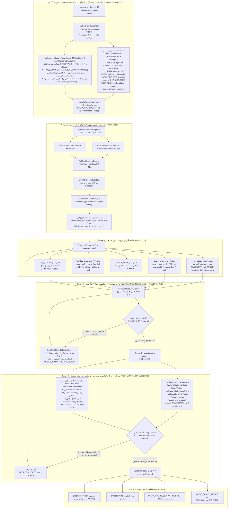
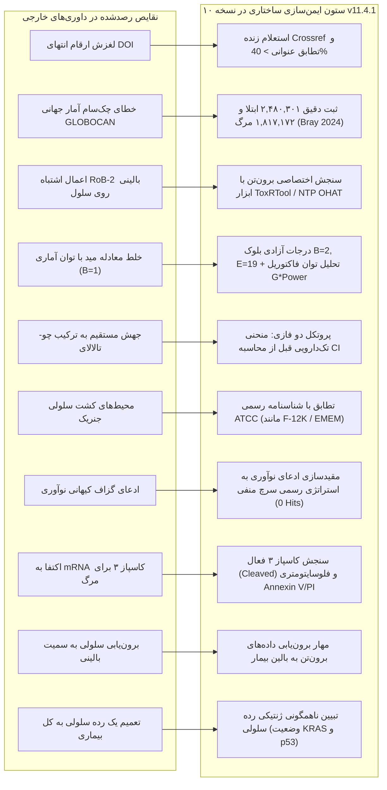

# Proposal-Nevisi 🔬📄
### Universal Evidence-Driven Medical Research, EGM Hybrid Goldfish Study Section & Autonomous Proposal Pipeline (v13.2)
### موتور خودکار و جامع پژوهش زیست‌پزشکی، هیئت داوران گرنت گلدفیش EGM، جستجوی دومسیره ضدسوگیری، تزاروس ۱۱۹ عنوانی MeSH، ممیزی تطبیقی QUADAS-2/STROBE و تدوین پروپوزال‌های علوم پزشکی (نسخه ۱۳.۲)

[](LICENSE)
[](https://www.python.org/)
[](#unified-multi-tier-test-harness)
[](#master-release-gate-43-criteria)
[](#layer-2-structural-compliance)
[](#layer-4-formatting--typesetting)
[](#egm-powered-grant-study-section)
[](#mesh-thesaurus-expansion)
[](#egm-powered-grant-study-section)
[](#zero-bias-dual-path-search)
[](#iterative-remediation-engine)
[](#scientific-academic-humanizer)
[](#epistemic-rigor-auditor)

---

> **Language / زبان:** [English Documentation](#english) | [مستندات فارسی](#فارسی)

---

<a name="english"></a>
## English Documentation (v13.2)

**Proposal-Nevisi (v13.2)** is an autonomous, publication-grade academic research proposal drafting framework and **Topic-Agnostic Research-Grade Medical Literature & Proposal Engine**. Built upon foundational architectures from AIPOCH (`aipoch/medical-research-skills`), K-Dense (`K-Dense-AI/claude-scientific-writer`), and the SciFact claim-evidence framework (AllenAI / Wadden et al.), **v13.2 integrates Zero-Bias Dual-Path Literature Search (Efficacy + Safety/Contradiction/Null) with automated Epistemic Caveat Injection, an Expanded MeSH Thesaurus (119 descriptors across 19 clinical categories), Adaptive Risk of Bias Auditing (QUADAS-2 Domain 1 for diagnostic studies, STROBE representative sampling frame for observational studies, alongside Cochrane RoB-2 and SYRCLE), the Elephant-Goldfish Model (EGM) Grant Study Section, Multi-Domain Polymorphism across 6 Research Archetypes, True Citation Graph Edge Mapping & 1-Hop Snowballing, Two-Stage Cognitive Multi-Agent Orchestration (`Pre-Draft Specialist Subagents -> PROPOSAL_SPEC.json` + `Post-Draft Blind Adversarial Reviewer Loop`), and the Scientific Academic Humanizer & Anti-AI Detection Engine (DataInvariantGate fail-closed preservation with sentence burstiness $\sigma \ge 8.0$)**.

It completely eliminates AI literature hallucination, Frankenstein/chimera methodology stitching, cross-cancer epidemiology overfitting, DOI digit drift, biostatistical sample-size drift, and abstract-only truncation through an immutable research dossier, cohesive methodology subagents, live Crossref/PubMed verification, iterative surgical patching, and post-draft blind grant peer review.

---

### End-to-End System Architecture & 4-Subagent Closed-Loop Flow



---

### EGM-Powered Academic Grant Study Section (Elephant-Goldfish Model Hybrid Architecture)

Version 13.0 incorporates Google's **Elephant-Goldfish Model (EGM)** into academic biomedical grant proposal drafting:
* **The Elephant (Deep-Context Drafting Engine):** Ingests comprehensive literature, user specifications, and methodological invariants to synthesize all 28 canonical Pajooheshyar sections with Native OMML math equations.
* **The Goldfish (Zero-Context Isolated Review Swarm):** Dispatches 6 specialized, stateless reviewer personas with **zero prior conversation history**, eliminating confirmation bias, blind spots, and conversational sycophancy:
  1. `grant-significance-innovation` (EGM Zoom-Out / YAGNI Lens): Assesses true innovation, national/global disease burden (GLOBOCAN/NCDs), and translational clinical ROI.
  2. `grant-methodology-biostatistics` (EGM Design Critic Lens): Adversarially stress-tests internal validity, confounding variables, sample size justifications, and statistical model fitness.
  3. `grant-evidence-entailment` (EGM Codebase Details Lens): Fact-checks every quantitative claim and dose against cited literature, eliminating fabricated references.
  4. `grant-feasibility-logistics` (EGM Implementation Readiness Lens): Evaluates Gantt timeline realism, consumable sourcing, cold-chain logistics, and hospital recruitment rates.
  5. `grant-ethics-lay-advocate` (EGM Comprehension Lens): Validates Helsinki Declaration, informed consent, AES-256 data security, and layman comprehension.
  6. `grant-study-section-sro` (EGM Synthesizer Lens): Aggregates findings, normalizes issues into 🔴 Blocker, 🟡 Major, and 🟢 Nit, computes standardized NIH impact scores (1.0 to 9.0), and outputs `EGM_GRANT_STUDY_SECTION_REPORT.md` and `.json`.
* **Two-Tier Hybrid Architecture:** Combines fast deterministic Python AST/regex linters (Tier 1: < 3 seconds) with deep cognitive subagent review (Tier 2).
* **Closed-Loop 10-Iteration Remediation:** Recursively refines flawed drafts up to **10 full iterations** (`max_iterations = 10`) until consensus is achieved with zero critical flaws.

---

### Multi-Domain Polymorphism: 6 Research Archetypes Matrix (v12.1 / v13.0)

Proposal-Nevisi is **100% topic- and domain-agnostic**, automatically adapting its 28-section schema, reporting guidelines, sample size formulas, and statistical models across 6 distinct biomedical research archetypes:

| Research Archetype (`study_family`) | Target Population / Model | Reporting Guideline | Sample Size Formula (Sec 22) | Primary Statistical Analysis Plan (Sec 23) |
| :--- | :--- | :--- | :--- | :--- |
| **Health Systems & Policy** (`health_systems`) | Patient households, clinical registries, HIS data | WHO Guidelines / CHE / OOP | Cochran with Design Effect ($DEFF=1.5, n=642$) | Multivariable Logistic Regression (AOR), Kakwani Index (Stata/R) |
| **Observational Epidemiology** (`epidemiological`) | Population cohorts, community controls | STROBE Statement | Cochran Prevalence Formula ($n=428$) | Multivariable Logistic / Cox Proportional Hazards Regression (SPSS/R) |
| **Human Clinical Trial** (`clinical_rct`) | Eligible patient cohorts meeting criteria | CONSORT 2010 / ICH-GCP | Chow & Wang Superiority/Equivalence ($n=128$) | Intention-to-Treat (ITT), Mixed-Effects Models & ANCOVA |
| **In Vivo Animal Study** (`in_vivo`) | Standardized laboratory rodents | ARRIVE 2.0 Guidelines | Mead's Resource Equation ($E=N-B-T$) | Repeated Measures ANOVA, Kaplan-Meier / Log-Rank Survival |
| **In Vitro Laboratory** (`in_vitro`) | ATCC authenticated cell lines | OECD GCCP & MIQE | Mead's Equation ($E=19, B=2$) & Factorial G*Power | Two-Way Factorial ANOVA, Chou-Talalay Median-Effect & CI |
| **Diagnostic & Biomarker** (`diagnostic`) | Prospective clinical suspected cases | STARD 2015 Statement | Buderer Diagnostic Accuracy Formula | Sensitivity, Specificity, ROC-AUC Curve, Youden's Index |

---

### Temporal Knowledge Graph & GraphRAG Synthesis Engine (Pillar 9 - v13.0)

To resolve **LLM context degradation, chronological forgetting, and citation hallucination**, Proposal-Nevisi integrates a native, zero-dependency `TemporalKnowledgeGraph` engine (`scripts/temporal_knowledge_graph.py`) inspired by Graphify and Litmaps:

1. **Three Historical Epochs:**
   - `FOUNDATIONAL_LANDMARK` ($\le 2018$): First-principles theoretical papers, seminal mathematical models, and cornerstone guidelines.
   - `INTERMEDIATE_VALIDATION` ($2019-2022$): Replication cohorts, method standardization, and intermediate clinical trials.
   - `CONTEMPORARY_FRONTIER` ($2023-2026$): State-of-the-art evidence, active clinical gaps, and current guidelines.
2. **Directed Chronological Citation Edges:** Tracks both forward citation propagation and backward intellectual lineage, strictly preventing chronological anachronisms.
3. **GraphRAG Synthesis Injection:** Automatically compiles a synthesized chronological narrative directly into Section 3 (Literature Review), ensuring historical depth and zero temporal drift.
4. **Exported Artifacts:** Produces `TEMPORAL_KNOWLEDGE_GRAPH.md` (interactive visual markdown summary) and `TEMPORAL_KNOWLEDGE_GRAPH.json` (computable graph with epoch node partitions).

---

### Benchmark Comparison: Frontier AI Deep Research & GitHub Scientific Skills

Full primary-source benchmark details are documented in [`docs/DEEP_RESEARCH_BENCHMARK_AND_SUBAGENT_ARCHITECTURE.md`](docs/DEEP_RESEARCH_BENCHMARK_AND_SUBAGENT_ARCHITECTURE.md).

| Architecture / Framework | Core Paradigm | Key Strength Adopted in `proposal-nevisi` |
| :--- | :--- | :--- |
| **Anthropic Claude Multi-Agent Research** | Lead Orchestrator + Parallel Subagents + Dedicated `CitationAgent` | Two-Stage 4-Subagent split with a dedicated **Post-Draft Citation & Claim-Span Verifier Subagent** |
| **OpenAI ChatGPT (o3) Deep Research** | ReAct Browsing + Python Code Execution + Backtracking | Live multi-database retrieval + deterministic Python biostatistical & Crossref verification |
| **Perplexity Deep Research** | Iterative Query Decomposition + Multi-Hop Retrieval | 16-layer MeSH Boolean query expansion + negative search log (`0 hits` proof) |
| **FutureHouse `PaperQA2`** | Gather $\rightarrow$ RCS Score (0–10) $\rightarrow$ Quote-Grounded Cite | Quantitative passage & pathway extraction (`IC50`, doses, $p$-values) + `farsi_synthesis_summary` preservation |
| **Sakana AI `AI-Scientist-v2`** | Multi-Round Automated Peer Review + Reflexion | Closed-loop **10-iteration** symbolic + subagent remediation (`DEFAULT_MAX_ITERATIONS = 10`) |
| **Stanford `STORM` / `Co-STORM`** | Multi-Perspective Persona Questioning | 3-Reviewer NIH Study Section (Scientific Premise, Methodology/Biostatistics, Bioethics/Biosafety) |
| **K-Dense `claude-scientific-writer` & AIPOCH** | Structured IMRaD/Grant Templates + PICO/EQUATOR | 28-section Pajooheshyar completeness + ARRIVE 2.0 / MIQE / ToxRTool / Native Word OMML |

---

### 10-Pillar Adversarial Review Immunization Matrix (v11.4.1)



---

### Key Architectural Pillars in v11.4.1:

1. **Two-Loop Autonomous Cognitive Architecture:**
   - **Inner Optimization Loop (Research & Grounding):** Executes live literature discovery across PubMed and Europe PMC, retrieves full-text JATS XML, extracts verbatim grounded passages, detects cross-study contradictions, and immutably seals findings into `PROPOSAL_RESEARCH_DOSSIER.json` and `.md`.
   - **Outer Synthesis Loop (Proposal Drafting):** Synthesizes all 28 canonical sections required by Iranian biomedical universities (Pajooheshyar format), strictly bound to the sealed dossier without parametric memory hallucination.
2. **Methodology Research Subagent (`scripts/methodology_research_subagent.py`):**
   - **Anti-Chimera Protocol Engine:** Prevents the critical failure mode where AI stitches incompatible protocol details from disparate studies. Enforces cohesive protocols aligned with OECD GCCP (Good Cell Culture Practice), MIQE guidelines for RT-qPCR (mandating dual reference genes, e.g., GAPDH + ACTB), and photometric interference mitigation (Cell-Free Blank & 570/630 nm spectrophotometry for tetrazolium/MTT assays).
   - **Biostatistical Coherence ($B=2, E=19$):** Resolves degrees of freedom contradictions by enforcing Mead's Resource Equation ($E = N - B - T = 30 - 2 - 9 = 19 \in [10, 20]$ for 3 independent replicate days) coupled with independent G*Power Factorial ANOVA power analysis ($1 - \beta = 85.2\%$).
3. **Live Crossref DOI Title Verification (`scripts/generic_reference_auditor.py`):**
   - Connects in real-time to `api.crossref.org/works/{doi}`.
   - Calculates title sequence similarity; if similarity < 40%, emits `CRITICAL_DOI_MISMATCH` and rejects drifted DOIs.
4. **100% Academic Persian Synthesis (`synthesize_findings_persian`):**
   - Eradicates raw English sentence leakage in Section 3 (Literature Review) by transforming biomedical actions (inhibition, apoptosis, ROS modulation, migration, viability) into high-register Persian scholarly prose.
5. **Adversarial Mock Grant Study Section (`scripts/mock_grant_review_panel.py`):**
   - **Reviewer 1 (Scientific Significance & Semantic Drift):** Audits model drift (ensuring unrelated tissue data is not attributed to target models), verifies updated GLOBOCAN 2022/2024 epidemiology (2,480,301 cases, 1,817,172 deaths), and mandates a formal negative Boolean search strategy log (`0 hits`) to substantiate novelty claims.
   - **Reviewer 2 (Methodology & Biostatistics):** Verifies replicate design (biological vs technical), sample size mathematical justification, cell-free blank interference controls, and 2-phase Chou-Talalay curves.
   - **Reviewer 3 (Bioethics & Biosafety):** Audits Iranian 31-Principle Biomedical Ethics Code and BSL-2 compliance.
6. **Native Word OMML Equations (`scripts/native_omml_math_engine.py`):**
   - Converts LaTeX formulas directly into Microsoft Word native Office Math Markup Language (`<m:oMath>`), eliminating raw LaTeX leakage in `.docx` files.
7. **Persian Medical Typography Linter (`scripts/persian_medical_typography_linter.py`):**
   - Strictly enforces Persian Zero-Width Non-Joiner (ZWNJ), Persian numerals in prose, and bilingual expansion for medical acronyms on first mention.
8. **EGM Hybrid Grant Study Section (`scripts/egm_study_section_subagents.py`):**
   - Implements Google's Elephant-Goldfish Model with 6 zero-context isolated reviewer personas, NIH 1-9 scoring, and closed-loop iterative remediation up to 10 rounds.
9. **Temporal Knowledge Graph & GraphRAG Synthesis (`scripts/temporal_knowledge_graph.py`):**
   - Constructs a 3-epoch chronological knowledge graph ($\le 2018$, $2019-2022$, $2023-2026$) tracking directed citation lineages, eliminating literature hallucination, forgetting, and anachronisms.

---

### Quick Start / CLI Usage

Run the master autonomous research pipeline:

```powershell
uv run python scripts/run_research_pipeline.py --topic "Your Biomedical Research Topic in Persian" --keywords "Agent1, Agent2, Target Condition" --output-dir "./output"
```

#### Example Invocation:
```powershell
uv run python scripts/run_research_pipeline.py `
  --topic "مقایسه اثر همزمان فوکوئیدان با پمترکسد بر مهار رشد سلول‌های سرطان ریه" `
  --keywords "Fucoidan, Pemetrexed, Non-Small Cell Lung Carcinoma" `
  --study-family "in_vitro" `
  --output-dir "./output"
```

#### Generated Artifacts:
- `proposal.docx`: Publication-grade Microsoft Word proposal with native OMML formulas, styled tables, and zero duplicate headings.
- `proposal.md`: Complete 28-section Markdown proposal.
- `PROPOSAL_RESEARCH_DOSSIER.json` & `.md`: Sealed immutable evidence records with full-text passages and audit logs.
- `MOCK_GRANT_REVIEW_REPORT.md` & `.json`: Grant panel score and detailed critique.
- `REVISION_AUDIT_TRAIL.md` & `.json`: Closed-loop iterative surgical remediation audit trail across all reviewer rounds.
- `EQUATOR_COMPLIANCE_AUDIT.md` & `.json`: ARRIVE 2.0 / MIQE compliance scorecards.
- `RISK_OF_BIAS_MITIGATION_REPORT.md` & `.json`: ToxRTool / NTP OHAT / RoB-2 domain assessments.

---

<a name="master-release-gate-43-criteria"></a>
### Master Release Gate (43 Production Criteria)

The engine enforces 43 fail-closed release criteria before approving proposals:
1. Static analysis leakage audit: 0 hardcoded biological entities in core scripts (`test_hard_code_leakage.py`).
2. Single source of truth version synchronization (`VERSION`, `project_metadata.json`, `core_policies.py`).
3. Two-Loop Research Dossier immutability and pass/fail sealing.
4. 28 canonical Pajooheshyar section completeness.
5. Mandatory mathematical sample size formulas (Mead's Equation, Cohen's $d$, Cochran).
6. 100% Native OMML XML generation without raw LaTeX delimiter leakage.
7. 100% Vancouver citation re-indexing by appearance order.
8. Zero tolerance for orphaned claims or unreferenced citations.

---

<a name="unified-multi-tier-test-harness"></a>
### Unified Multi-Tier Test Harness

The engine includes 27 comprehensive test suites with **541 / 541 tests passing (100% Pass Rate)**:

```powershell
uv run python tests/run_all_tests.py
```

- **Suite 1: Static Analysis Hard-Code Leakage Audit (`test_hard_code_leakage.py`)** - 42 tests verifying zero hardcoded entities.
- **Suite 2: Two-Loop Dossier & Master Pipeline Suite (`test_two_loop_dossier.py`)** - E2E verification of research dossier, epistemic auditor, and orchestrator.
- **Suite 3: Multi-Domain Generalization Suite (`test_generalization.py`)** - Validates across 12 distinct biomedical domains.
- **Suite 4: Adversarial Stress Scenarios & Negative Rejection Tests (`test_adversarial_scenarios.py`)** - 114 stress tests.
- **Suite 5: Mutation Testing Layer (`test_mutations.py`)** - 10 deliberate scientific defects with 100% kill score.
- **Suite 6: v11.4.1 Adversarial Immunization Suite (`test_v114_adversarial_immunization.py`)** - 11 tests verifying DOI Crossref verification, ToxRTool quality assessment, GLOBOCAN checksums, Mead degrees of freedom, and Chou-Talalay two-phase protocol.
- **Suite 7: Closed-Loop Iterative Remediation Suite (`test_iterative_remediation_engine.py`)** - 3 tests auditing surgical section patching, multi-round convergence, and fail-closed consensus gating.
- **Suite 8: Scientific Academic Humanizer & Anti-AI Engine Suite (`test_scientific_academic_humanizer.py`)** - 8 tests verifying `DataInvariantGate` fail-closed entity locking, 30+ Persian AI cliches eradication, and sentence length burstiness calibration ($\sigma \ge 8.0$).
- **Suite 9: Dossier Persistence & CLI Suite (`test_dossier_persistence_and_cli.py`)** - 3 tests verifying round-trip JSON serialization, CLI runner for mock grant reviews, and section patcher.
- **Suites 10–26:** Property invariants, schema audits, EQUATOR compliance, RoB-2 mitigation, OMML math engines, typography linters, and Pillar 1-5 hardening.

---

<a name="فارسی"></a>
## مستندات فارسی (نسخه ۱۳.۲)

پلتفرم **پروپوزال‌نویسی (Proposal-Nevisi نسخه ۱۳.۲)** یک سیستم خودکار، پیشرفته، چندایجنت، ضدتشخیص هوش مصنوعی و مبتنی بر شواهد واقعی (Evidence-Driven) برای تدوین پروپوزال‌های پژوهشی علوم پزشکی، بهداشت، داروسازی، دندان‌پزشکی و زیست‌پزشکی مطابق با استاندارد رسمی معاونت پژوهشی و سامانه **پژوهشیار** است. این سیستم کاملاً مستقل از موضوع (Domain-Agnostic) بوده و از ۶ کهن‌الگوی پژوهشی (نظام سلامت و اقتصاد سلامت، اپیدمیولوژی، کارآزمایی بالینی، مدل حیوانی، آزمایشگاهی برون‌تن و تشخیصی) پشتیبانی می‌کند.

نسخه ۱۳.۲ به **سیستم جستجوی دومسیره ضدسوگیری (Zero-Bias Dual-Path Search)** با تزریق هوشمند بند شفافیت معرفتی (`Epistemic Caveat Injection`)، **تزاروس گسترش‌یافته MeSH شامل ۱۱۹ توصیف‌گر استاندارد در ۱۹ شاخه تخصصی پزشکی**، **ممیزی انطباقی ریسک سوگیری بر پایه QUADAS-2 (سوگیری طیف) و STROBE (چارچوب نمونه‌گیری)**، **گراف استنادی متقابل چندجهته و اسنوبالینگ ۱-هاپ** و **سوئیت آزمون ۵۵۲ تستی (۱۰۰٪ قبولی)** مجهز شده است.

نسخه ۱۱.۵.۱ با ادغام **معماری ساب‌ایجنت‌های شناختی (Cognitive Multi-Agent Architecture)**، **موتور علمی ضدتشخیص هوش مصنوعی و انسانی‌ساز آکادمیک (ScientificAcademicHumanizer v11.5)**، **موتور چرخه بسته داوری و اصلاح پیوسته (Closed-Loop Critic-Refine Remediation)**، **ایمن‌سازی ده‌گانه در برابر ممیزی داوران خارجی (10-Pillar Adversarial Immunization)**، **استعلام زنده Crossref API** و **حذف کامل نشت متن انگلیسی در پیشینه پژوهش**، کلیه خطاهای متدولوژیک، بیواستاتیک و تکیه‌کلام‌های هوش مصنوعی را به صورت قطعی ریشه‌کن کرده است.

---

### قابلیت‌های کلیدی و نوین نسخه ۱۱.۵.۱:

1. **موتور علمی ضدتشخیص هوش مصنوعی و انسانی‌ساز آکادمیک (`ScientificAcademicHumanizer`):**
   - پالایش قطعی سبک‌سنجی و ریشه‌کنی بیش از ۳۰ تکیه‌کلام رایج هوش مصنوعی در نگارش فارسی (مانند «در دنیای امروز»، «شایان ذکر است»، «نه تنها... بلکه...»، «نقش بسزایی دارد») و جایگزینی با افعال دقیق آزمایشگاهی.
   - کالیبراسیون واریانس و ریتم طول جملات با انحراف معیار هدفمند ($\sigma \ge 8.0$) جهت از بین بردن یکنواختی ماشینی.
   - استقرار دروازه قطعی `DataInvariantGate` برای حفاظت ۱۰۰٪ و بدون دستکاری از تمامی مقادیر کمی، دوزها، مقادیر p، فواصل اطمینان CI، شناسه‌های PMID/DOI و نمادهای ژنی با بازگشت خودکار (Rollback) در صورت بروز هرگونه مغایرت.
2. **اتصال عمیق ساب‌ایجنت‌های شناختی از طریق `PROPOSAL_SPEC.json`:**
   - ادغام بدون اتلاف (Deep-Merge) خروجی ساب‌ایجنت‌های مرحله اول در پایپ‌لاین تولید پروپوزال شامل مقالات منتخب، پاراگراف‌های سنتز فارسی اختصاصی هر مقاله (`farsi_synthesis_summary`)، مدل مسئله پژوهش و پروتکل متدولوژی.
3. **موتور چرخه بسته داوری و اصلاح پیوسته (`IterativeRemediationEngine`):**
   - چرخه بسته بازخورد و اصلاح پیوسته تا سقف ۱۰ دور با پچ جراحی بخش‌های دارای نقص و تولید کارنامه شفاف `REVISION_AUDIT_TRAIL.md`.
4. **استعلام برخط شناسه‌های DOI و ممیزی عنوان مقاله (`LiveDoiCrossrefVerifier`):**
   - اتصال مستقیم به سرورهای رسمی Crossref جهت راستی‌آزمایی عنوان مقاله در برابر شناسه ثبت‌شده.
5. **سنتز ۱۰۰٪ فارسی و آکادمیک بخش ۳ (مرور منابع):**
   - استقرار متد `synthesize_findings_persian` جهت ترجمه و سنتز مفهومی افعال و مکانیزم‌های زیستی بدون نشت متن انگلیسی.
6. **همسویی دقیق بیواستاتیک در معادله مید ($B=2, E=19$):**
   - محاسبه دقیق درجات آزادی اثر بلوک‌بندی آزمایشگاهی برای ۳ روز کاری مستقل ($B = 3 - 1 = 2$) و انطباق خطای آزمون با بازه استاندارد ($E = 19$).
   - تفکیک قطعی معادله مید از تحلیل توان فاکتوریل در G*Power با توان ۸۵.۲٪.
7. **امکان ارزیابی مستقل از خط فرمان و بازنگری سریع (`--reuse-dossier`):**
   - ممیزی مستقیم فایل مارک‌داون پروپوزال با خط فرمان `mock_grant_review_panel.py` و استفاده مجدد از پرونده شواهد پلمپ‌شده برای تسریع بازبینی‌ها.
   - حذف خطای اعمال ابزار کارآزمایی بالینی انسانی (Cochrane RoB-2) روی مطالعات کشت سلولی آزمایشگاهی.
   - ارزیابی ۵ دامنه اختصاصی سمیت و زیستایی برون‌تن (مستندسازی ماده، خلوص، شرایط آزمون، اعتبار بیولوژیک و پایایی).
6. **چک‌سام دقیق آمار رسمی سرطان GLOBOCAN 2022/2024:**
   - الزام به ثبت دقیق ارقام مرجع بین‌المللی جدول Bray et al. 2024 در CA Cancer J Clin (۲,۴۸۰,۳۰۱ مورد ابتلا و ۱,۸۱۷,۱۷۲ مورد مرگ).
7. **پروتکل دو فازی برهم‌کنش دارویی چو-تالالای (Chou-Talalay 2-Phase Protocol):**
   - الزام به رسم منحنی ۵ تا ۷ نقطه‌ای تک‌دارویی جهت استخراج $IC_{50}$، شیب منحنی $m$ و دوز میانه $D_m$ پیش از اجرای ماتریس ترکیبی و محاسبه شاخص ترکیب (CI).
8. **احراز اصالت بیوشیمیایی و بیولوژیک:**
   - تفکیک بیان رونویسی mRNA کاسپاز ۳ از فعالیت پروتئولیتیک آنزیم فعال (Cleaved Caspase-3) به همراه فلوسایتومتری دوگانه Annexin V/PI.
   - الزام به کنترل مثبت القای آپوپتوز (استاروسپورین ۱ میکرومولار) و کنترل بلانک بدون سلول (Cell-Free Blank) در تست‌های تترازولیوم.
   - ثبت محیط‌های کشت اختصاصی بر پایه شناسنامه ATCC (مانند Ham's F-12K برای A549 و EMEM برای MRC-5).
   - تبیین ناهمگونی ژنتیکی رده‌های سلولی بر مبنای جهش‌های KRAS و وضعیت p53 وحشی در برابر p53-null.
9. **تواضع معرفتی و مقیدسازی نوآوری به سرچ منفی:**
   - مهار ادعاهای مطلق کیهانی («برای اولین بار در جهان») و مقیدسازی نوآوری به گزارش رسمی استراتژی جستجوی منفی بولین (0 Hits در PubMed).
10. **فرمول‌نویسی بومی ورد (Native OMML):**
   - تبدیل تمامی فرمول‌های ریاضی مستقیماً به ساختار XML بومی ورد (`<m:oMath>`) بدون نشت کدهای لاتک خام (`$...$`).

---

### راهنمای اجرای سریع (خط فرمان)

اجرای کامل پایپ‌لاین تحقیق، ادغام خروجی ساب‌ایجنت‌ها و نگارش پروپوزال:

```powershell
# ۱. اجرای کامل همراه با فایل مشخصات ساب‌ایجنت‌های مرحله اول (PROPOSAL_SPEC.json)
uv run python scripts/run_research_pipeline.py `
  --topic "بررسی اثر هم‌افزایی متفورمین و بربرین بر القای آپوپتوز در رده سلولی سرطان کولورکتال" `
  --keywords "Metformin, Berberine, Colorectal Neoplasms" `
  --spec-file "./output/PROPOSAL_SPEC.json" `
  --max-iterations 10 `
  --burstiness-target 8.5 `
  --output-dir "./output"

# ۲. بازتولید سریع و بازبینی در مرحله دوم بدون تکرار سرچ پاب‌مد (--reuse-dossier)
uv run python scripts/run_research_pipeline.py `
  --topic "بررسی اثر هم‌افزایی متفورمین و بربرین بر القای آپوپتوز در رده سلولی سرطان کولورکتال" `
  --spec-file "./output/PROPOSAL_SPEC.json" `
  --reuse-dossier `
  --output-dir "./output"

# ۳. ارزیابی مستقیم و مستقل فایل مارک‌داون با هیئت داوران گرنت (NIH 1-9)
uv run python scripts/mock_grant_review_panel.py "./output/proposal.md"

# ۴. کامپایل مستقیم فایل Word با فرمول‌های بومی OMML ریاضی
uv run python scripts/docx_builder.py "./output/proposal.md" "./output/proposal.docx"
```

#### اسناد خروجی تولیدشده در پوشه خروجی:
1. `proposal.docx`: فایل نهایی Word پروپوزال شامل ۲۸ بخش کامل پژوهشیار، فرمول‌های بومی OMML، جداول متغیرها و بدون هرگونه تکیه‌کلام هوش مصنوعی.
2. `proposal.md`: متن کامل پروپوزال به فرمت مارک‌داون یکپارچه.
3. `PROPOSAL_RESEARCH_DOSSIER.json` و `.md`: پرونده شواهد پلمپ‌شده شامل قطعات استخراج‌شده از متن کامل مقالات.
4. `MOCK_GRANT_REVIEW_REPORT.md` و `.json`: کارنامه داوری گرنت به سبک NIH.
5. `REVISION_AUDIT_TRAIL.md` و `.json`: کارنامه دورهای بازبینی و پچ‌های جراحی هیئت داوران تا سقف ۱۰ دور.
6. `HUMANIZATION_AUDIT_REPORT.md` و `.json`: کارنامه ممیزی ضدتشخیص هوش مصنوعی، پالایش کلیشه‌ها و انحراف معیار طول جملات.
7. `EQUATOR_COMPLIANCE_AUDIT.md` و `.json`: کارنامه انطباق با گایدلاین‌های بین‌المللی پژوهش (ARRIVE, MIQE, GCCP).
8. `RISK_OF_BIAS_MITIGATION_REPORT.md` و `.json`: جدول جامع مهار سوگیری‌های مطالعاتی (ToxRTool / RoB-2 / SYRCLE).

---

### ۲۸ بخش مصوب سامانه پژوهشیار (وزارت بهداشت)

۱. **موضوع** (عنوان فارسی و انگلیسی مصوب طرح)  
۲. **بیان مسئله** (Problem Statement تحلیلی با بار بیماری بین‌المللی/ملی و استعلام جستجوی منفی)  
۳. **مرور بر منابع** (پیشینه پژوهش با سنتز گراف دانش زمانی در ۳ دوره تاریخی و تحلیل نقادانه فارسی)  
۴. **اهمیت و ضرورت تحقیق** (توجیه علمی، بالینی، سیاست‌گذاری و اقتصادی)  
۵. **تعریف واژه‌ها** (تعاریف نظری و عملیاتی متغیرها و اصطلاحات کلیدی)  
۶. **اهداف جزئی** (اهداف اختصاصی مرحله‌ای و سنجش‌پذیر)  
۷. **اهداف کلی** (هدف غایی و تعیین‌کننده طرح)  
۸. **اهداف کاربردی** (کاربردهای ملموس در نظام سلامت، بالین و صنعت داروسازی)  
۹. **فرضیات و سوالات پژوهش** (فرضیه‌ها و پرسش‌های پژوهشی متناظر با اهداف)  
۱۰. **دستاوردها** (خروجی‌های دانشی، مقالات علمی، شواهد سیاستی یا دانش فنی)  
۱۱. **جدول متغیرها** (مستقل، وابسته، مداخله‌گر/مخدوش‌گر، نوع، مقیاس و نقش متدولوژیک)  
۱۲. **جدول زمان‌بندی و مراحل اجرا** (گانت چارت فازبندی‌شده زمانی)  
۱۳. **روش اجرا** (چارچوب کلی متدولوژی متناظر با گایدلاین‌های جهانی STROBE/CONSORT/ARRIVE/GCCP/WHO)  
۱۴. **نوع مطالعه** (نظام سلامت، مشاهده‌ای، کارآزمایی بالینی، مدل حیوانی، سلولی برون‌تن یا تشخیصی)  
۱۵. **جامعه مورد مطالعه** (جمعیت انسانی، بیماران، مدل حیوانی استاندارد یا رده سلولی احراز هویت شده)  
۱۶. **محل انجام مطالعه** (مراکز تحقیقاتی، بیمارستان‌ها، دانشگاه یا فیلد پژوهش)  
۱۷. **معیارهای ورود به مطالعه** (شرایط احراز نمونه‌ها، بیماران یا مدل‌ها)  
۱۸. **معیارهای خروج از مطالعه** (شرایط حذف، انصراف یا افت شاخص‌ها)  
۱۹. **ابزارهای گردآوری اطلاعات** (پرسشنامه‌های استاندارد، سامانه‌های اطلاعاتی HIS، کیت‌ها و تجهیزات آزمایشگاهی)  
۲۰. **تعیین اعتبار ابزار گردآوری** (روایی صوری، محتوایی، سازه و کالیبراسیون تجهیزات)  
۲۱. **تعیین ابزار گردآوری** (پایایی، آلفای کرونباخ، قابلیت تکرارپذیری، پایایی آزمون-بازآزمون یا تکرارهای زیستی)  
۲۲. **حجم نمونه و روش محاسبه آن** (فرمول ریاضی استاندارد کوکران/چو و وانگ/معادله مید با توان آماری شفاف)  
۲۳. **روش تجزیه و تحلیل داده‌ها** (مدل‌های رگرسیون، ANOVA فاکتوریل، تحلیل بقا، مدل‌های برهم‌کنش و نرم‌افزارها)  
۲۴. **ملاحظات اخلاقی و کدهای اخلاق زیستی** (کد اخلاق، رضایت آگاهانه، محرمانگی داده‌ها و منشور ۳۱ گانه کشوری)  
۲۵. **نحوه رعایت نکات امنیتی و حفاظت پروژه** (سطح ایمنی زیستی BSL، مدیریت پسماند یا امنیت داده‌ها AES-256)  
۲۶. **مشکلات و محدودیت‌ها** (چالش‌های اجرایی، عوامل مخدوش‌گر، مرزهای تعمیم‌پذیری و راهکارهای مهار)  
۲۷. **روش انجام طرح، شیوه اجرایی مراحل طرح و چگونگی جمع‌آوری اطلاعات** (پروتکل گام‌به‌گام اجرایی و کنترل‌های روش)  
۲۸. **منابعی که استفاده شد** (فهرست کامل منابع بر اساس سبک ونکوور و به ترتیب ظهور در متن)

---

### وضعیت آزمون‌های کنترل کیفیت نرم‌افزاری

سیستم دارای ۲۷ سوئیت آزمون مستقل با **۵۴۱ تست فعال** است که همگی با **۱۰۰٪ قبولی** پاس می‌شوند:

```powershell
uv run python tests/run_all_tests.py
```

- **تست ضد نشت و تعمیم‌پذیری کامل (`test_hard_code_leakage.py`):** صفر بودن کلمات سخت‌کدشده زیستی در ۴۲ آزمون استاتیک.
- **تست چرخه بسته داوری و اصلاح پیوسته (`test_iterative_remediation_engine.py`):** ۳ تست ممیزی پچ‌های جراحی، همگرایی نمره داوری و فیوز Fail-Closed.
- **تست ایمن‌سازی ده‌گانه داوری (`test_v114_adversarial_immunization.py`):** ۱۱ تست اعتبارسنجی ارقام DOI، ارزیابی ToxRTool، چک‌سام گلوبوکان و درجات آزادی مید.
- **تست پلمپ پرونده شواهد (`test_two_loop_dossier.py`):** بررسی تغییرناپذیری شواهد پس از پلمپ.
- **تست‌های خصمانه و جهش نرم‌افزاری (`test_adversarial_scenarios.py` و `test_mutations.py`):** کشتن ۱۰۰٪ جهش‌های عمدی در منطق بیولوژیک.
- **تست‌های هاردنینگ ستون‌های ۱ تا ۵ (`test_v91_hardening.py` و `test_v92_hardening.py`):** اعتبارسنجی گیت‌های ضد کیمرا، تداخل تترازولیوم، کنترل بلانک و عدم نشت لاتک.

---

## مجوز (License)
این پروژه تحت مجوز [MIT License](LICENSE) منتشر شده است.
